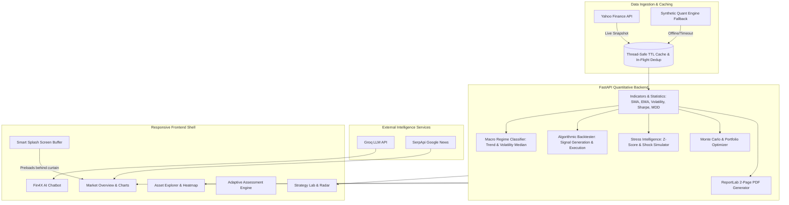

# Fin4X | Finsights Tailored Just for You

> **Enterprise-Grade Quantitative Multi-Asset Financial Intelligence, Automated Stress Simulation, Algorithmic Backtesting & Educational Analytics Platform**

[](https://www.python.org/)
[](https://fastapi.tiangolo.com/)
[](https://www.chartjs.org/)
[](https://plotly.com/javascript/)
[](https://www.reportlab.com/)
[](https://groq.com/)
[](LICENSE)

---

## 📌 Executive Overview

**Fin4X** transforms multi-asset market history into an institutional-grade quantitative research workspace. Built for finance students, researchers, quantitative analysts, and algorithmic traders, Fin4X unifies real-time market data ingestion, statistical indicators, machine-learning market regimes, stochastic Monte Carlo simulations, stress testing, and algorithmic strategy backtesting inside a single, blazing-fast browser dashboard.

The platform eliminates the typical setup friction of quantitative research: it features an **instant-start branded loading screen** that synchronizes in the background with live market feeds, thread-safe in-flight request deduplication, an automated 2-page publication-quality PDF research brief generator, a rule-based adaptive financial knowledge assessment engine, and an AI research assistant powered by Groq.

> **Research & Educational Disclaimer**: *Fin4X is engineered for quantitative research, algorithmic analysis, and financial education. Historical data analysis and hypothetical simulated backtests do not guarantee future market performance.*

---

## 🚀 Key Modules & Capabilities

### 1. Market Overview & Multi-Asset Tape
- **Real-Time Cross-Asset Monitoring**: Tracks **Gold** (defensive anchor / store of value), **Bitcoin** (high-beta crypto / liquidity proxy), and **NVIDIA** (growth tech equity / AI compute leader) simultaneously.
- **Normalized Comparison Tape**: Visualizes relative normalized performance across 1-year, 2-year, and 5-year horizons.
- **Contextual Tooltips**: Interactive explanations on every metric card detailing live real-time price, 24h change, and annualized Sharpe ratio.
- **Static Light-Green Signal Indicator**: Live status monitor confirming continuous quantitative feed connectivity.

### 2. Asset Explorer & Technical Indicator Engine
- Comprehensive technical overlays: **SMA 50**, **EMA 50**, and **EMA 200** with dynamic golden-cross / death-cross trend flags.
- Realized statistical metrics: Daily percentage return, cumulative return, 21-day rolling return momentum, annualized volatility ($\sigma \times \sqrt{252}$), annualized Sharpe ratio ($R_f = 4.5\%$), and peak-to-trough historical drawdown.
- Interactive multi-period zoom (1Y, 2Y, 5Y).

### 3. Cross-Asset Dependency & Correlation Lab
- **Static Correlation Heatmap**: Computes Pearson cross-asset correlation matrix across all tracked assets.
- **Rolling Correlation Dynamics**: Tracks 60-day rolling pair correlations over time to detect macro regime decouplings, flight-to-safety episodes, and cross-asset beta shifts.

### 4. Strategy Lab & Algorithmic Backtester
- Test and compare 4 distinct algorithmic strategy models:
  - **EMA Trend Following**: Exponential moving average crossovers with dynamic directional holding.
  - **SMA Crossover**: Classic golden-cross / death-cross strategy with configurable fast and slow windows.
  - **Momentum Oscillator**: Price rate-of-change momentum tracking.
  - **Mean Reversion**: Statistical counter-trend swing trading based on rolling price bands.
- **Institutional Realism**: Configurable initial capital, position sizing ($0.1$ to $1.0$), fast/slow moving average windows, and execution friction / transaction costs ($0.1\%$ default).
- **Execution Analytics**: Strategy vs. Buy & Hold benchmark equity curves, Sharpe ratio comparison, maximum drawdown reduction, win rate percentage, and granular trade-by-trade execution log.
- **Signal Quality Radar**: 5-axis quantitative score evaluating Sharpe ratio, return generation, drawdown protection, win rate, and volatility dampening.

### 5. Macro Climate & Market Regimes
- **4-State Macro Climate Decomposition**: Automatically segments market history into discrete regimes:
  - 🟢 **Bull / Low Volatility**: Steady, low-variance upward trend (optimal for trend following).
  - 🟡 **Bull / High Volatility**: Fast-moving, volatile expansion rallies with elevated dispersion.
  - 🔵 **Bear / Low Volatility**: Prolonged, quiet grinding downtrends.
  - 🔴 **Bear / High Volatility**: Acute crisis liquidations, panic selloffs, and shock spikes.
- **Upright Regime Return Profile**: Visual distribution chart comparing cumulative returns achieved inside each discrete climate.
- **Strategy Matrix**: Comparative performance breakdown showing which quantitative strategies excel under each specific macro climate.

### 6. Automated Market-Stress Intelligence
- **Machine-Detected Stress Conditions**: Evaluates rolling volatility z-scores, peak drawdown velocity, and 99% 1-day Tail Value-at-Risk (VaR) to autonomously detect active market stress.
- **Automated Shock Recommendations**: Prescribes tailored stress test scenarios:
  - *Market Crash* ($-20\%$ to $-50\%$ equity shock)
  - *Volatility Spike* ($2.5\times$ variance expansion)
  - *Liquidity Shock* (Sudden bid-ask spread expansion and gap down)
  - *Shock & Rapid Recovery* (V-shaped crash with mean-reversion)
- **Baseline vs. Stressed Path Projection**: Interactive dual-curve visualization quantifying portfolio capital impairment under severe systemic shocks.

### 7. Advanced Quantitative Lab
- **Monte Carlo Stochastic Simulation**: Simulates up to 500 geometric Brownian motion price paths across 30 to 180 trading days, generating median expected prices and 10th–90th percentile confidence boundaries.
- **Markowitz Portfolio Optimizer**: Performs Monte Carlo search across 2,000 weight allocations to identify the Maximum Sharpe Ratio tangency portfolio and Minimum Volatility portfolio on the Efficient Frontier.
- **Value at Risk (VaR) & Expected Shortfall (CVaR)**: Computes 1-Day 95% and 99% parametric and historical VaR alongside Conditional Value at Risk (Expected Shortfall).
- **Unsupervised Machine Learning Regimes**: Employs K-Means algorithmic clustering on rolling return and volatility features to discover latent market states (*Defensive*, *Balanced*, *Risk-on*).
- **Paper Trading Simulator**: Interactive simulated order entry (Market Buy / Sell) with real-time portfolio cash accounting and live mark-to-market position valuation.

### 8. Automated Research Brief & PDF Report Generator
- **Instant Institutional PDF Export**: One-click generation of a 2-page, publication-quality quantitative research report generated natively via ReportLab.
- **Report Contents**: Executive summary, asset comparison metrics, backtest strategy equity curve, drawdown chart, macro regime matrix, automated stress vulnerability projection, and formal compliance disclaimers.

### 9. Adaptive Financial Knowledge Self-Assessment
- **Rule-Based Adaptive Engine**: Personalized diagnostic test assessing financial knowledge without pre-set question sequences.
- **Dual Evaluation Tracks**:
  - *Path A (Foundations)*: Core market mechanics, risk vs. return, asset classes, and compounding.
  - *Path B (Quantitative & Systematic)*: Technical indicators, moving averages, Sharpe ratio, drawdowns, and algorithmic backtesting.
- **Detailed Gap Analysis & Verified Resources**: Identifies specific knowledge strengths, highlights conceptual gaps, and maps directly to curated, verified external educational guides (CFA Institute, Investopedia, Khan Academy, Coursera, CME Group).

### 10. AI Quant Research Assistant & Global Macro Feed
- **Groq-Powered AI Assistant**: Contextual financial research chatbot backed by ultra-fast Groq LPU inference, providing plain-English explanations of formulas, regime dynamics, and backtest results.
- **Global Macro News Feed**: Real-time financial market news integration via SerpApi Google News with category filters for Gold, Bitcoin, and NVIDIA.

---

## 🏗️ Architecture & Workflow



---

## 📁 Repository Structure

```text
Fin4X/
├── backend/
│   ├── assistant_config.py      # Groq LLM configuration & model settings
│   ├── backtester.py            # Portfolio backtesting simulation engine
│   ├── engine.py                # Yahoo Finance ingestion, indicator calculations & cache
│   ├── main.py                  # FastAPI server, REST routing & static file serving
│   ├── news.py                  # Google News feed integration via SerpApi
│   ├── report_generator.py      # Publication-quality 2-page PDF report generator
│   ├── requirements.txt         # Backend Python dependencies
│   ├── stress_intelligence.py   # Automated volatility z-score & stress detector
│   ├── test_cache.py            # Unit tests for thread-safe caching & deduplication
│   ├── test_news.py             # Unit tests for SerpApi news parser & fallback
│   ├── test_report.py           # Unit tests for PDF generation & page integrity
│   └── test_stress.py           # Unit tests for automated stress detection workflows
├── frontend/
│   ├── app.js                   # Client-side routing, Chart.js/Plotly rendering & API logic
│   ├── assessment_engine.js     # Rule-based adaptive diagnostic testing session class
│   ├── assessment_questions.js  # Curated multi-path question bank (Foundations & Quant)
│   ├── assessment_resources.js  # Curated external educational resource directory
│   ├── figure_captions.js       # Accessible interactive educational captions for charts
│   ├── index.html               # Main application single-page shell
│   ├── metric_definitions.js    # Financial metric registry & interactive popover tooltips
│   ├── styles.css               # Clean responsive theme & visual design system
│   └── test_assessment.js       # Node.js automated tests for adaptive assessment engine
├── .env.example                 # Template for optional API environment keys
├── requirements.txt             # Root Python package dependencies
├── render.yaml                  # Cloud deployment configuration for Render
└── README.md                    # Comprehensive documentation and setup guide
```

---

## 💻 Prerequisites

Ensure the following tools are installed on the host system:

- **Python 3.10+** (Python 3.11, 3.12, or 3.13 supported). Verify with `python --version` or `python3 --version`.
- **Git** (for cloning the repository).
- **Modern Web Browser** (Google Chrome, Mozilla Firefox, Microsoft Edge, or Safari).
- *(Optional)* **Node.js 18+** (Required only if you wish to run the frontend assessment unit tests).

---

## 🛠️ Installation & Setup (Step-by-Step)

Follow these instructions to set up and run Fin4X on any system:

### 1. Clone the Repository

```bash
git clone https://github.com/your-username/Fin4X.git
cd Fin4X
```

---

### 2. Set Up a Python Virtual Environment

#### On Windows (PowerShell):
```powershell
# Create virtual environment
python -m venv .venv

# Activate virtual environment
.\.venv\Scripts\Activate.ps1
```

> *If PowerShell prevents script execution, run: `Set-ExecutionPolicy -Scope Process -ExecutionPolicy Bypass` and then run the activation script again.*

#### On Windows (Command Prompt):
```cmd
python -m venv .venv
.\.venv\Scripts\activate.bat
```

#### On macOS / Linux (Terminal):
```bash
python3 -m venv .venv
source .venv/bin/activate
```

---

### 3. Install Required Dependencies

Install all dependencies using the root requirements file:

```bash
pip install --upgrade pip
pip install -r requirements.txt
```

---

### 4. Configure Environment Variables (Optional)

Fin4X is designed to work **100% out of the box** without any external API keys (using built-in quantitative simulation fallbacks). However, if you wish to enable the live Groq AI Research Assistant and live Google News headlines:

1. Copy the `.env.example` file to create `.env`:

   ```bash
   # On Windows
   copy .env.example .env

   # On macOS / Linux
   cp .env.example .env
   ```

2. Open `.env` and insert your API keys:

   ```ini
   # Optional: Groq LLM Key for AI Assistant (https://console.groq.com/keys)
   GROQ_API_KEY=gsk_your_actual_groq_api_key_here
   GROQ_MODEL=openai/gpt-oss-20b

   # Optional: SerpApi Key for Google News headlines (https://serpapi.com/)
   SERPAPI_API_KEY=your_actual_serpapi_key_here
   ```

---

### 5. Launch the Application

From the root project directory, run:

```bash
uvicorn backend.main:app --reload --host 0.0.0.0 --port 8000
```

> **Important**: Always run `uvicorn backend.main:app` from the **root directory** of the repository (not from inside the `backend/` folder) so that static frontend assets and modules resolve correctly.

---

### 6. Access the Application

Open your browser and navigate to:

```text
http://localhost:8000
```

- **Interactive API Documentation (Swagger UI)**: `http://localhost:8000/docs`
- **Alternative API Documentation (ReDoc)**: `http://localhost:8000/redoc`

---

## 🧪 Running Automated Tests

Fin4X includes comprehensive test suites covering thread-safety, API caching, PDF compilation, stress detection workflows, and the adaptive assessment engine.

### Run Backend Unit & Integration Tests (pytest)
Make sure your virtual environment is active, then run:

```bash
python -m pytest backend/ -v
```

*Expected output: All 22 tests passing across `test_cache.py`, `test_news.py`, `test_report.py`, and `test_stress.py`.*

### Run Frontend Assessment Unit Tests (Node.js)
```bash
node frontend/test_assessment.js
```

*Expected output: Verified question banks, dynamic branching, convergence logic, and curated educational recommendations.*

---

## 📡 REST API Reference

The FastAPI backend exposes clean, fully documented REST endpoints:

| Method | Endpoint | Description | Query / Body Parameters |
| :--- | :--- | :--- | :--- |
| `GET` | `/api/health` | Service health status | None |
| `GET` | `/api/assets` | Live multi-asset overview tape & summaries | `period` (`1y`, `2y`, `5y`) |
| `GET` | `/api/assets/{asset}` | Historical OHLCV, moving averages, and statistics | `asset` (`gold`, `bitcoin`, `nvidia`), `period` |
| `POST` | `/api/backtest` | Executes algorithmic strategy simulation | JSON payload: `asset`, `strategy`, `period`, `initial_capital`, `position_size`, `fast_window`, `slow_window`, `transaction_cost` |
| `GET` | `/api/correlation` | Pearson correlation matrix and 60-day rolling pairs | `period` (`1y`, `2y`, `5y`), `window` (int) |
| `GET` | `/api/regimes/{asset}` | Macro regime classification and chronological timeline | `asset` (`gold`, `bitcoin`, `nvidia`) |
| `GET` | `/api/regime-performance/{asset}` | Strategy comparison breakdown by discrete regime | `asset`, `regime` (`bull`, `bear`, `high_vol`, `low_vol`) |
| `GET` | `/api/stress/automated/{asset}` | Machine-detected market stress scenarios & shock recommendations | `asset` (`gold`, `bitcoin`, `nvidia`) |
| `GET` | `/api/stress/{asset}` | Simulated stress scenario execution | `asset`, `scenario` (`market_crash`, `volatility_spike`, `liquidity_shock`, `recovery`), `shock` (float) |
| `GET` | `/api/report/pdf` | Compiles and downloads 2-page publication-quality PDF | `asset`, `strategy`, `period` |
| `POST` | `/api/report/generate` | Generates PDF research report via JSON payload | JSON: `preferred_asset`, `preferred_strategy`, `lookback_period` |
| `GET` | `/api/advanced/forecast/{asset}` | Monte Carlo stochastic simulation paths | `asset`, `horizon` (days), `paths` (count) |
| `GET` | `/api/advanced/optimizer` | Markowitz Efficient Frontier portfolio optimizer | `iterations` (count), `risk_free_rate` (float) |
| `GET` | `/api/advanced/risk` | Parametric and Historical VaR & CVaR risk metrics | `confidence` (`0.95`, `0.99`), `days` (horizon) |
| `GET` | `/api/advanced/ml-regimes` | K-Means clustering market state identification | `asset` (`gold`, `bitcoin`, `nvidia`) |
| `GET` | `/api/advanced/paper` | Current state of paper trading portfolio | None |
| `POST` | `/api/advanced/paper/order` | Executes a paper buy/sell order | Query: `asset`, `side` (`buy`, `sell`), `quantity` (float) |
| `POST` | `/api/assistant` | Submits quantitative prompt to Groq AI Assistant | JSON: `message`, `history` (list of messages) |
| `GET` | `/api/news` | Real-time financial market news articles | `asset` (`all`, `gold`, `bitcoin`, `nvidia`), `limit`, `refresh` |

---

## ⚡ Reliability & Performance Highlights

- **Smart Startup Curtain**: Front-loads real-time data fetching behind a lightweight branded splash screen, ensuring that dashboard cards and charts are completely populated before being revealed (zero visible `"Syncing..."` lag).
- **In-Flight Request Deduplication**: Prevents duplicate downstream requests to Yahoo Finance when multiple tabs or components request the same asset data simultaneously.
- **Thread-Safe In-Memory Cache**: Caches price snapshots and computationally intensive statistical indicators for 5 minutes (`TTL = 300s`) with automatic memory bounding.
- **Zero-Friction Fallback**: If external market data feeds experience rate-limiting or internet disruption, Fin4X immediately activates its high-fidelity stochastic simulation engine without crashing or throwing errors.
- **Accessible Tooltip Architecture**: Centralized definitions registry in `metric_definitions.js` providing accessible, plain-English explanations for every numerical indicator across the platform.

---

## ⚖️ Research Guardrails & Methodological Integrity

1. **Look-Ahead Bias Elimination**: All backtest trading signals are shifted by $+1$ session before applying daily returns, preventing signals calculated on day $T$ close from unrealistically capturing day $T$ returns.
2. **Friction Accounting**: Incorporates realistic transaction cost drag (default $0.1\%$ per executed trade) to avoid overly optimistic high-frequency trading results.
3. **Benchmark Normalization**: Strategy equity curves are evaluated directly against passive Buy & Hold baselines over identical timeframes.
4. **Non-Promissory Educational Framework**: The platform disclaims any guarantee of live trading profitability and highlights model limitations such as slippage, bid-ask spread expansion, and regime transition lag.

---

## 📄 License

This project is licensed under the **MIT License**. See the `LICENSE` file for details.
